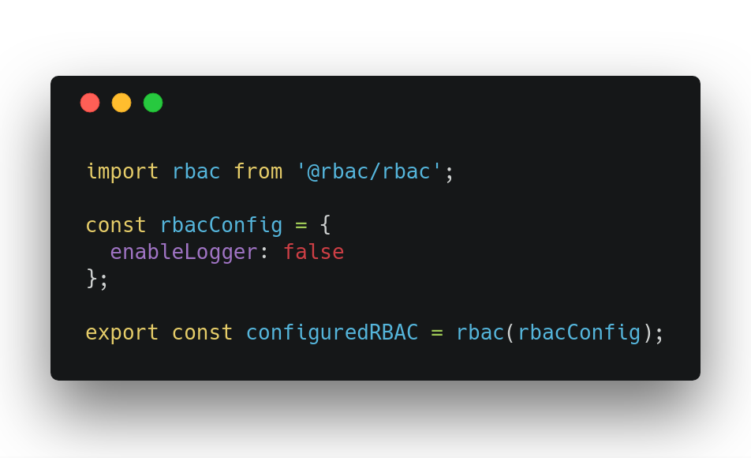
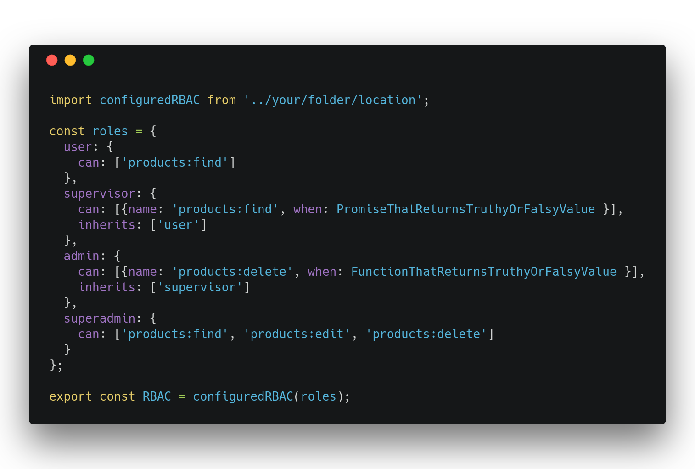
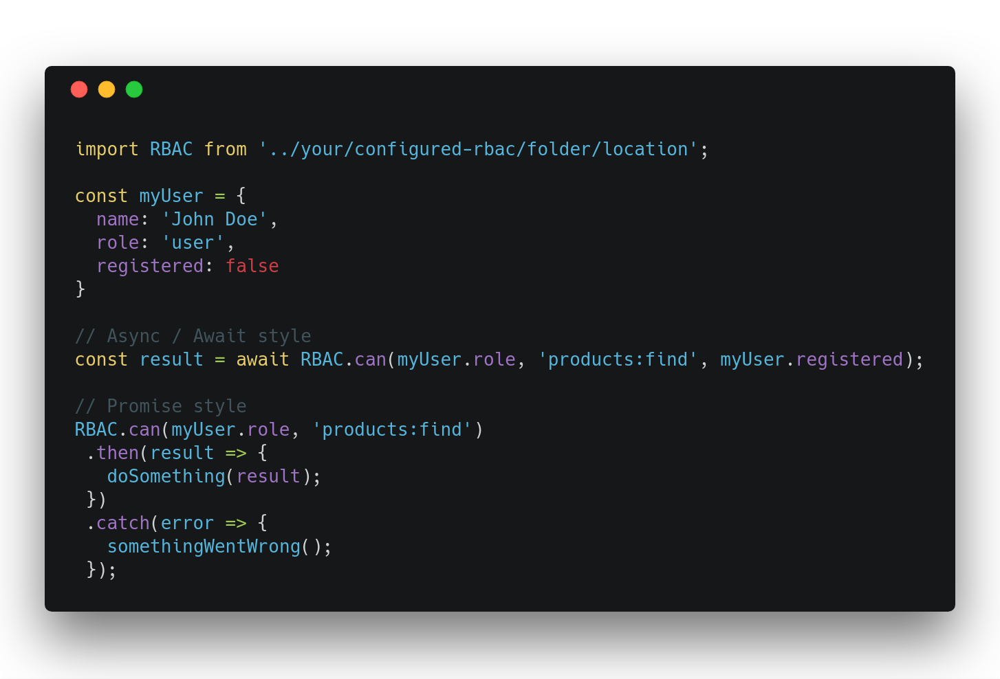

<p align="center">
  
</p>

<h1 align="center">
  Hierarchical Role-Based Access Control for Node.js
</h1>

[](https://circleci.com/gh/phellipeandrade/rbac/tree/master)
[](https://badge.fury.io/js/@rbac%2Frbac)
[](https://twitter.com/intent/tweet?text=checkout%20RBAC%20project%20on%20Github!&url=https://github.com/phellipeandrade/rbac&hashtags=rbac,authorization,privacy,security,permission)


* ⏱ Lightweight
* ⚡️Fastest RBAC (check benchmarks)
* ️🍃low dependency

## Features

* Focused on operations
* Scalable
* Each role is given specific access rights for every operation
* High granularity in assigning rights
* Wildcard and regex support for operations
* Optional database adapters (MongoDB, MySQL, PostgreSQL)
* Express, NestJS and Fastify middlewares
* Roles can be updated at runtime

## Thanks

  The package is compiled with **TypeScript** and exposes CommonJS and ESM
  entrypoints backed by a single module instance.

  Thanks to Karl Düüna ([DeadAlready](https://github.com/DeadAlready)) and his awesome [post on medium](https://blog.nodeswat.com/implement-access-control-in-node-js-8567e7b484d1)
  
  
## Getting Started

#### Install

Requires **Node.js 22.12 or later**. Install with `npm install @rbac/rbac`.

This library is written in TypeScript and the published package ships with
its declaration files for a great developer experience.

#### Import

The package supports both ES modules and CommonJS.

**ES Modules**

```ts
// Default import
import RBAC from '@rbac/rbac';

// Named imports
import { createTenantRBAC, MongoRoleAdapter } from '@rbac/rbac';

// Combined
import RBAC, { createTenantRBAC } from '@rbac/rbac';
```

**CommonJS**

```js
// Default import
const RBAC = require('@rbac/rbac');

// Named imports
const { createTenantRBAC, MongoRoleAdapter } = require('@rbac/rbac');

// Combined
const RBAC = require('@rbac/rbac');
const { createTenantRBAC } = require('@rbac/rbac');
```

#### Usage

RBAC is a curried function thats initially takes an object with configurations, 
then returns another function that takes an object with roles, 
finally returns an object that holds "can" property that is a function.

You can use it in many ways, below is one of them:

#### Setup RBAC config


| Property     	| Type          	| Params                                                      	| Default       	| Description                             	|
|--------------	|---------------	|-------------------------------------------------------------	|---------------	|-----------------------------------------	|
| logger       	| **Function**  	| role: **String**<br/>operation: **String**<br/>result: **Boolean**<br/>colorsEnabled: **Boolean** (optional) 	| defaultLogger 	| Function that logs operations to console 	|
| enableLogger 	| **Boolean**   	|                                                             	| true          	| Enable or disable logger                	|
| colors       	| **Boolean**   	|                                                             	| auto-detect   	| Enable, disable, or auto-detect color support in logger output 	|

#### Creating some roles


RBAC expects an object with roles as property names.

| Property 	| Type         	| Example                                        	| Description                                                                                                                                                                  	|
|----------	|--------------	|------------------------------------------------	|------------------------------------------------------------------------------------------------------------------------------------------------------------------------------	|
| can      	| **Array**    	            | ```['products:*']```                        	| Array of strings, list of operations that user can do, it also supports glob patterns                                                                                            |
| when          | **Function, Async Function or Promise**       | ```(params , done ) =>  done (null , true )``` 	| **Optional** Promise that should resolve in Truthy or Falsy, an async function that returns a boolean or Promise, or a Callback function that receives params and done as properties, should return done passing errors and result 	|
| inherits 	| **Array**    	            | ```['user']```                                 	| **Optional** Array of strings, list of roles inherited by this role                                                                                                               	|

The **`when`** property accepts a synchronous predicate, an async predicate, a
Promise, or a legacy Node-style callback. New callback predicates should be
wrapped explicitly with `callbackWhen` from `@rbac/rbac/helpers`, without
relying on a function's parameter count. Example:

```ts
import type { Roles } from '@rbac/rbac';
import { callbackWhen } from '@rbac/rbac/helpers';

interface Params {
  registered: boolean;
}

const roles: Roles<Params> = {
  supervisor: {
    can: [{ name: 'products:find', when: callbackWhen<Params>((params, done) => {
      // done receives error as first argument and Truthy or Falsy value as second argument
      done(null, params.registered);
    }) }]
  },
  admin: {
    can: [{ name: 'products:*', when: async (params) => {
      return params.registered;
    } }]
  }
};

```

#### Check if user can do some operation


| Param  	| Type        	                                 | Example                  	| Description                                                    	|
|--------	|----------------------------------------------- |--------------------------	|----------------------------------------------------------------	|
| First  	| **String**  	                                 | ```'admin'```            	| Array of strings, list of operations that user can do          	|
| Second 	| **String**, **Glob (Wildcard)**, **Regex**     | ```'products:find'```    	| Operation to validate                                          	|
| Third  	| **Any**     	                                 | ```{registered: true}``` 	| **Optional** Params that will flow to "when" callback Function 	|
### Update roles at runtime

RBAC exposes two helpers to modify the role definition at runtime. `addRole` adds a new role and `updateRoles` merges new definitions with the existing ones.

```ts
import RBAC from '@rbac/rbac'

const base = RBAC({ enableLogger: false })({
  user: { can: ['products:find'] }
})

base.addRole('editor', { can: ['products:update'], inherits: ['user'] })
await base.can('editor', 'products:update') // true

base.updateRoles({
  user: { can: ['products:find', 'products:create'] }
})
await base.can('user', 'products:create') // true
```

### Database adapters

RBAC exposes optional adapters to load and persist role definitions using
MongoDB, MySQL or PostgreSQL. Each adapter implements the `RoleAdapter`
interface with `getRoles`, `addRole` and `updateRoles` methods.

```ts
import RBAC from '@rbac/rbac'
import { MongoRoleAdapter } from '@rbac/rbac/adapters'

const adapter = new MongoRoleAdapter({
  uri: 'mongodb://localhost:27017',
  dbName: 'mydb',
  collection: 'roles'
})

const roles = await adapter.getRoles()
const rbac = RBAC()(roles)
```

Adapters available:

- `MongoRoleAdapter`
- `MySQLRoleAdapter`
- `PostgresRoleAdapter`

Adapters also allow customizing the underlying table or collection column names
through a `columns` option when creating a new instance:

```ts
const adapter = new MySQLRoleAdapter({
  table: 'roles',
  columns: { name: 'rname', role: 'rdef', tenantId: 'tid' }
})
```

SQL table names and column names must be valid identifiers (letters, digits, and
underscores, starting with a letter or underscore). Tables may also use a
schema-qualified name such as `public.roles`. Invalid names are rejected when
constructing an SQL adapter.

### Multi-tenant RBAC

Adapters can optionally receive a `tenantId` parameter to store and retrieve
roles for different tenants. When omitted, the adapter falls back to a default
tenant so existing single-tenant usage keeps working. Use `createTenantRBAC` to
instantiate an RBAC instance scoped to a tenant:

```ts
import { MongoRoleAdapter, createTenantRBAC } from '@rbac/rbac';

const adapter = new MongoRoleAdapter({ uri: 'mongodb://localhost:27017', dbName: 'mydb', collection: 'roles' });

await adapter.addRole('user', { can: ['products:find'] }, 'tenant-a');

const rbacTenantA = await createTenantRBAC(adapter, 'tenant-a');
await rbacTenantA.can('user', 'products:find'); // true
```

Want more? Check out the [examples](examples/) folder.

### Middlewares

RBAC also provides helper middlewares for **Express**, **NestJS** and **Fastify**.
They make it easy to guard routes using existing role definitions.

```ts
import RBAC, { createExpressMiddleware } from '@rbac/rbac';

const rbac = RBAC({ enableLogger: false })({
  user: { can: ['products:find'] }
});

const canFindProducts = createExpressMiddleware(rbac)('products:find');

app.get('/products', canFindProducts, handler);
```

For NestJS, use `createNestGuard(rbac)(operation)` with `@UseGuards(...)` for
HTTP authorization. Its `canActivate` method follows Nest's guard contract.
`createNestMiddleware` remains available for applications that register a
traditional `(req, res, next)` Nest middleware.

For Fastify, use `createFastifyMiddleware(rbac)(operation)` as a `preHandler`
hook, providing `getRole` and optionally `getParams` for request-specific data.

Validation schemas are available separately via `@rbac/rbac/schemas` (also
`@rbac/rbac/roles.schema`). Importing the package root does not load Zod.

### Custom Logger

You can provide a custom logger function to integrate with your logging infrastructure:

```ts
const customLogger = (role: string, operation: string | RegExp, result: boolean) => {
  // Send to your logging service
  logger.info({ role, operation, result, timestamp: Date.now() });
};

const rbac = RBAC({ logger: customLogger })(roles);
```

The logger receives `role`, `operation`, `result`, and an optional `colorsEnabled` parameter. Disable logging with `enableLogger: false`.

### Logger Color Configuration

The default logger automatically detects color support and applies ANSI color codes when appropriate. You can manually control this behavior via the `colors` configuration option:

```ts
// Force colors disabled (plain text output)
const rbac = RBAC({ enableLogger: true, colors: false })(roles);

// Force colors enabled
const rbac = RBAC({ enableLogger: true, colors: true })(roles);

// Auto-detect (default) - checks FORCE_COLOR, NO_COLOR, TTY, and CI environment
const rbac = RBAC({ enableLogger: true })(roles);
```

## Roadmap

- [X] Wildcard support
- [X] Regex support
- [X] Update roles in runtime
- [X] Async `when` callbacks
- [X] Database adapters (MongoDB, MySQL, PostgreSQL)
- [X] Middlewares for Express, NestJS and Fastify

## v2.0.0

- Rewritten in TypeScript
- Internal refactor focused on readability and performance
- Added support to update roles at runtime
- Database adapters
- Middlewares for Express, NestJS and Fastify

## Benchmarks

Run `npm run bench` to execute the performance suite. The script runs two end-to-end scenarios:

- **Baseline comparison** – compares `@rbac/rbac` with AccessControl, RBAC, Easy RBAC and Fast RBAC using the default dataset.
- **Large dataset comparison** – stresses the libraries with hundreds of resources, deep inheritance chains and three `when` flavours (callback, async function and promise).

For each scenario the suite generates detailed reports (JSON/CSV/HTML chart) under `benchmarks/results/` and prints a human-readable summary (ops/sec, margins, standard deviation, samples, etc.).

One local run measured the following throughput for `@rbac/rbac` (ops/sec; ± reported run margin):

| Scenario | Direct | Inherited | Glob | Callback condition | Async condition | Promise condition |
| --- | ---: | ---: | ---: | ---: | ---: | ---: |
| Baseline | 705,928 ±53.14% | 686,871 ±36.93% | 421,587 ±41.87% | — | — | — |
| Large dataset | 395,934 ±25.88% | 579,837 ±9.21% | 533,091 ±17.08% | 84,314 ±19.78% | 411,722 ±18.06% | 292,185 ±34.54% |

These are environment-specific measurements, and the reported margins show that results can vary between runs. The baseline comparison does not show `@rbac/rbac` leading every category; for example, Easy RBAC measured 1,125,560 ops/sec for direct permission checks in this run. See the JSON, CSV and HTML chart reports in `benchmarks/results/` for the full comparison.

## More Information

- [Migration guide from v1 to v2](docs/migrating-v1-to-v2.md)
- [Changelog](CHANGELOG.md)

## Contributing

#### Contributions are welcome!

1. Build RBAC
  * Run `npm ci` (Node.js 22.12+) to install locked dependencies
  * Run `npm run build` to compile TypeScript and generate the CommonJS/ESM entrypoints

2. Development mode
  * Run `npm run dev` to watch TypeScript sources for changes.

3. Running the tests
  * Run `npm test` and `npm run test:package`

4. Scripts
* `npm run build` - cleans `lib`, compiles TypeScript and generates CommonJS/ESM entrypoints
* `npm run dev` - produces development version of your library and runs a watcher
* `npm test` - runs unit and regression tests with coverage
* `npm run test:watch` - same as above but in a watch mode
* `npm run bench` - run the benchmark suite
* `npm run test:package` - checks exports and ESM/CommonJS identity
* `npm run lint` - runs ESLint 9 flat config
* `npm run typecheck` - runs TypeScript without emitting files

## License

This project is under MIT License [https://opensource.org/licenses/MIT]
