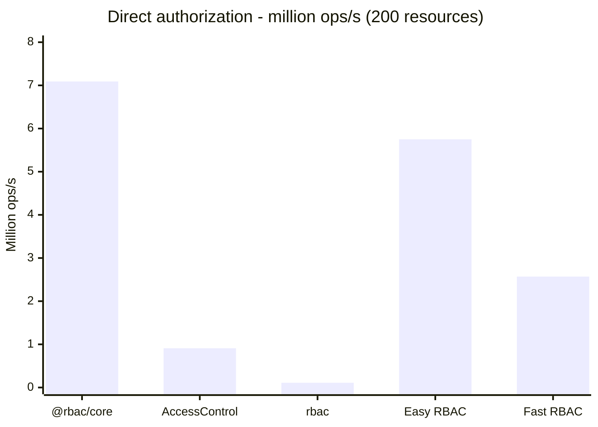

# Benchmarking @rbac/core

All benchmarks run against the built workspace package. Use Node.js 22.14.0
(the repository's `.nvmrc`) and run `npm run build` after changing TypeScript
source so the benchmark uses the updated JavaScript.

## Benchmark suites

| Command | Purpose | Output |
| --- | --- | --- |
| `npm run bench:micro` | Exact grant using stable vs interpolated strings, alongside bare `Set.has` | Terminal |
| `npm run bench:engine` | Exact, inherited, glob and regex grants, conditional allow/deny, misses and unknown roles | Terminal |
| `npm run bench` | AccessControl, `rbac`, Easy RBAC and Fast RBAC comparisons with small and 200-resource datasets | JSON, CSV, HTML |

The engine benchmark reports the **median of five samples**, each with
300,000 awaited `can()` calls after 50,000 warmup calls per scenario. Customize
its workload using `RBAC_BENCH_ITERATIONS`, `RBAC_BENCH_SAMPLES` and
`RBAC_BENCH_WARMUP`; use `node benchmarks/engine.js --json` for machine-readable
output. Every result is verified against the expected authorization decision.
It measures single-threaded throughput with logging disabled.

## Comparing other libraries

The comparison runner prebuilds operation strings outside timed callbacks.
In the large dataset, the glob scenario checks `resource0:archive`, covered
by `resource0:*` but **not** already granted by inheritance. Older report
files use different workloads and should not be compared directly.

By default, `npm run bench` writes to tracked `benchmarks/results/`. For a
non-destructive run, redirect its output to a temporary directory:

```powershell
$env:RBAC_BENCH_OUTPUT_DIR = Join-Path $env:TEMP 'rbac-bench-local'
npm run bench
```

These libraries do not have identical permission models or APIs. Compare
scenarios with equivalent effective grants, and measure argument construction
cost separately. Repeat on the same hardware, Node.js version and power
profile, without competing CPU-intensive processes. Single-run scores and
confidence intervals apply only to the tested environment.

## Measured results (2026-11-14)

Hardware: Intel Core i7-9700KF; Windows 11 Pro; Node.js v22.14.0.
Logging disabled. All values below are measured operations per second, not
guaranteed production throughput.

### Direct permission comparison



| Library | Small direct | Large direct | Large inherited | Large glob |
| --- | ---: | ---: | ---: | ---: |
| @rbac/core | 7,282,499 | 7,086,106 | 7,009,957 | 3,527,345 |
| AccessControl | 943,635 | 908,823 | 530,274 | N/A |
| rbac | 209,160 | 111,538 | 53,201 | N/A |
| Easy RBAC | 6,119,410 | 5,747,234 | 5,504,564 | 122,253 |
| Fast RBAC | 2,989,702 | 2,567,862 | 2,629,421 | 2,600,415 |

The large `@rbac/core` suite also measured 388,996 ops/s for
callback-based conditions (`setImmediate`), 2,152,776 for async predicates,
and 2,316,798 for resolved Promise predicates. The isolated engine suite
reported 11,821,309 exact checks/s and 12,864,770 inherited checks/s (median of
five samples). Its methodology differs from the comparison suite.

The separate `npm run bench:micro` run reported 14,055,829 ops/s for
stable-string RBAC exact checks and 3,662,664 for interpolated operations.
Native `Set.has` measured 16,382,823 and 3,739,846 ops/s respectively.
This native primitive does not perform a full RBAC authorization.

Source artifacts: [small JSON](results/rbac-comparison.json),
[small CSV](results/rbac-comparison.csv),
[small HTML chart](results/rbac-comparison.chart.html),
[large JSON](results/rbac-comparison-large.json),
[large CSV](results/rbac-comparison-large.csv),
[large HTML chart](results/rbac-comparison-large.chart.html), and
[engine JSON](results/rbac-engine.json).

See the [English](../website/docs/benchmarks.md) and
[pt-BR](../website/i18n/pt-BR/docusaurus-plugin-content-docs/current/benchmarks.md)
reports for the complete results. Competing packages use different APIs and
permission models; results do not prove identical semantics or a universal
performance ranking.

## Optimization guardrails

- Authorization correctness comes first: do not cache parameter-dependent
  results or change conditional OR, inheritance and fail-closed semantics.
- Shared resolved Promises remove repeated allocations for unconditional
  decisions with logging disabled. With logging enabled, every check still logs.
- Literal patterns may reuse cached static results; conditional predicates are
  reevaluated for every request and role updates invalidate the caches.
- Pattern caches remain bounded; complex regex/glob query semantics remain
  available when the fast literal path cannot decide.
