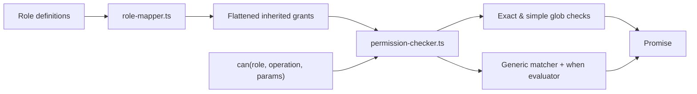

# Architecture

RBAC prepares flattened role mappings at construction and whenever roles change. The checker then evaluates operations using exact matching, indexed simple glob patterns, generic patterns, and condition evaluation.

## Source layout

| Directory | Purpose |
| --- | --- |
| `packages/core/src/rbac.ts` | Public factory and runtime role updates (`addRole`, `updateRoles`, `replaceRoles`). |
| `packages/core/src/core/role-mapper.ts` | Resolve inheritance and flatten grants. |
| `packages/core/src/core/permission-checker.ts` | Authoritative `can()` evaluation. |
| `packages/core/src/core/permission-*.ts` | Permission matching, context, caches, and data. |
| `packages/core/src/utils/when.ts` | Normalize Boolean, Promise, function, and callback predicates. |
| `packages/adapters/src/adapters/` | Optional persistent role adapters. |
| `packages/{express,fastify,nestjs}/src/` | Framework-specific route guards. |

The documentation playground imports the same engine source rather than implementing a separate evaluator. The visual role editor only translates its rule form into the engine's public role model. Database adapters are demonstrated with configuration snippets because they require server-side drivers and credentials.

The website is a separate Docusaurus application under `website/` and does not enter the published npm package. The TypeDoc reference is generated from the public module entrypoints on every build. Learn how to change content in the [website maintenance guide](https://github.com/phellipeandrade/rbac/blob/master/website/README.md).
