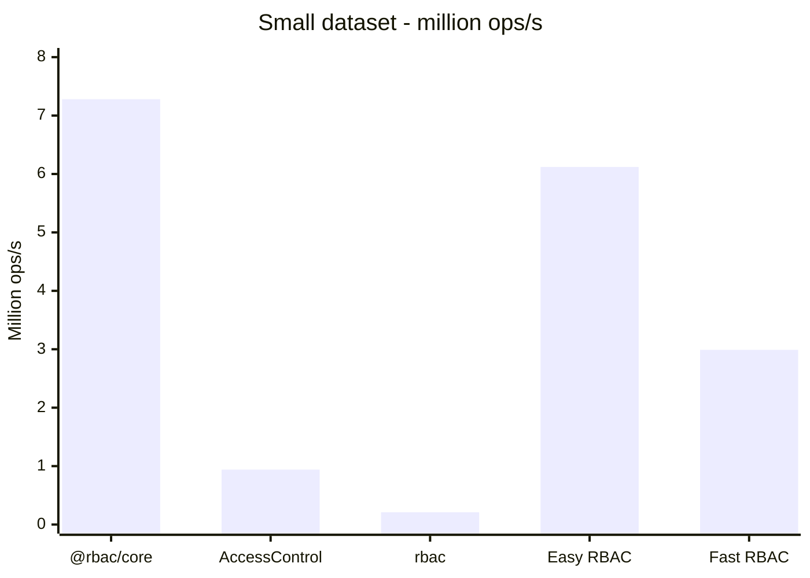
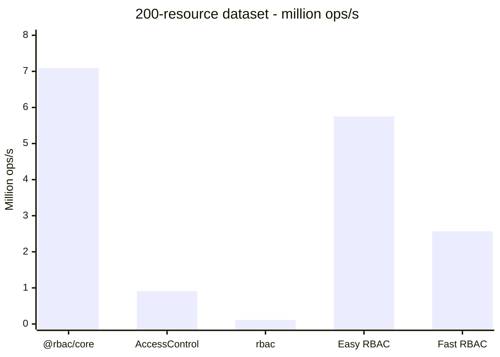
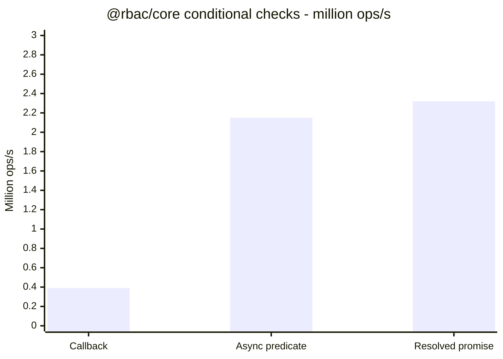

# RBAC performance benchmarks

Measured on **November 14, 2026**, using **Node.js 22.14.0** on **Windows 11 Pro / Intel Core i7-9700KF**. All values are **operations per second (ops/s)**; higher is better. Tests use the built v4 workspace, with logging disabled.

## Library comparison

The suite compares `@rbac/core`, `accesscontrol@2.2.1`, `rbac@5.0.3`, `easy-rbac@4.0.0` and `fast-rbac@2.0.1`. The small dataset uses a few roles and permissions; the large dataset has **200 resources**, inheritance, exact permissions and glob grants.

### Direct permission checks





### Full comparison (ops/s)

| Library | Small direct | Small inherited | Small glob | Large direct | Large inherited | Large glob |
| --- | ---: | ---: | ---: | ---: | ---: | ---: |
| **@rbac/core** | **7,282,499** | **7,330,012** | **3,982,917** | **7,086,106** | **7,009,957** | **3,527,345** |
| AccessControl | 943,635 | 668,308 | — | 908,823 | 530,274 | — |
| rbac | 209,160 | 201,247 | — | 111,538 | 53,201 | — |
| Easy RBAC | 6,119,410 | 364,966 | 3,091,113 | 5,747,234 | 5,504,564 | 122,253 |
| Fast RBAC | 2,989,702 | 2,871,606 | 2,840,481 | 2,567,862 | 2,629,421 | 2,600,415 |

An em dash means that suite exercises the library through an **admin permission** scenario instead of an equivalent glob API. All measurements include the cost of the library-specific `can()` invocation and any `await` in the timed callback. Different APIs and permission models make these **indicative throughput comparisons**, not proof of identical authorization semantics or a universal ranking.

## Conditional authorization

The large dataset also measures conditional grants in `@rbac/core`:



| Condition type | Ops/s |
| --- | ---: |
| Node-style callback (scheduled with `setImmediate`) | 388,996 |
| Async predicate | 2,152,776 |
| Resolved Promise | 2,316,798 |

Callbacks schedule additional work, so those figures are **not equivalent** to the cost of a synchronous predicate.

## Isolated engine measurements

`npm run bench:engine` repeats **300,000 checks per sample**, with **50,000 warmup checks** and **five samples per scenario**. The figures below are the median ops/s from that separate run:

| Scenario | Ops/s | Scenario | Ops/s |
| --- | ---: | --- | ---: |
| Exact grant | 11,821,309 | Inherited grant | 12,864,770 |
| Simple glob grant | 5,220,169 | Regex grant | 2,685,078 |
| Conditional sync | 2,357,719 | Conditional async | 2,596,618 |
| Conditional denial | 2,489,162 | Unmatched operation | 5,162,996 |
| Unknown role | 14,075,652 | Regex query | 1,168,111 |

The engine suite uses a different measurement harness from the third-party comparisons. **Do not compare its absolute throughput directly with the figures above.**

## Microbenchmark

The `npm run bench:micro` command measured a single exact grant using a stable string or an interpolated operation string, alongside bare `Set.has()` as a language-runtime reference:

| Operation | Stable string (ops/s) | Interpolated string (ops/s) |
| --- | ---: | ---: |
| RBAC exact permission | 14,055,829 | 3,662,664 |
| Native `Set.has()` | 16,382,823 | 3,739,846 |

This is a separate microbenchmark run; the native Set check does not implement the library's full authorization semantics.

## Reproduce and inspect results

From the repository root:

```bash
npm ci
npm run build
npm run bench:engine
npm run bench
```

`npm run bench` writes complete samples, statistics and interactive charts to `benchmarks/results/`. The committed files from this run are:

- [Small dataset: JSON](https://github.com/phellipeandrade/rbac/blob/master/benchmarks/results/rbac-comparison.json) · [CSV](https://github.com/phellipeandrade/rbac/blob/master/benchmarks/results/rbac-comparison.csv) · [HTML chart](https://github.com/phellipeandrade/rbac/blob/master/benchmarks/results/rbac-comparison.chart.html)
- [200-resource dataset: JSON](https://github.com/phellipeandrade/rbac/blob/master/benchmarks/results/rbac-comparison-large.json) · [CSV](https://github.com/phellipeandrade/rbac/blob/master/benchmarks/results/rbac-comparison-large.csv) · [HTML chart](https://github.com/phellipeandrade/rbac/blob/master/benchmarks/results/rbac-comparison-large.chart.html)
- [Engine benchmark: JSON](https://github.com/phellipeandrade/rbac/blob/master/benchmarks/results/rbac-engine.json)

The benchmark values depend on CPU, system load, JIT warmup and Node.js version. Rerun multiple times under comparable conditions, check authorization results for each competing API, and profile your own policy graph before drawing performance conclusions. See the [benchmark methodology](https://github.com/phellipeandrade/rbac/blob/master/benchmarks/benchmark.md) for suite details and output redirection.
