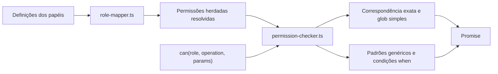

# Arquitetura

O RBAC prepara mapas de papéis com permissões herdadas na construção e sempre que os papéis são alterados. O mecanismo de verificação utiliza correspondência exata, índices de curingas simples, padrões genéricos e condições.

## Estrutura do código-fonte

| Diretório | Responsabilidade |
| --- | --- |
| `packages/core/src/rbac.ts` | Fábrica pública, `addRole` e `updateRoles`. |
| `packages/core/src/core/role-mapper.ts` | Resolve herança e unifica permissões. |
| `packages/core/src/core/permission-checker.ts` | Avaliação efetiva de `can()`. |
| `packages/core/src/core/permission-*.ts` | Correspondências, contexto, caches e dados. |
| `packages/core/src/utils/when.ts` | Normalização de condições Boolean, Promise, funções e callbacks. |
| `packages/adapters/src/adapters/` | Persistência opcional de papéis. |
| `packages/{express,fastify,nestjs}/src/` | Proteção de rotas por framework. |

O playground importa o mesmo motor de autorização utilizado pelo pacote, evitando duplicação de lógica. O editor visual apenas transforma o formulário no modelo público do RBAC. Adapters de banco são ilustrados com trechos de configuração porque exigem drivers e credenciais de backend.

O portal Docusaurus fica isolado em `website/` e não é publicado no npm. A referência TypeDoc é recriada a partir das entradas públicas a cada build. Veja o [guia de manutenção](https://github.com/phellipeandrade/rbac/blob/master/website/README.md).
