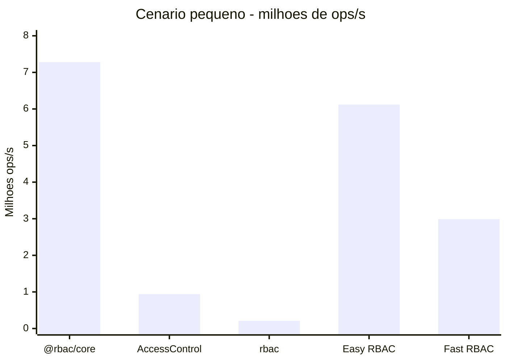
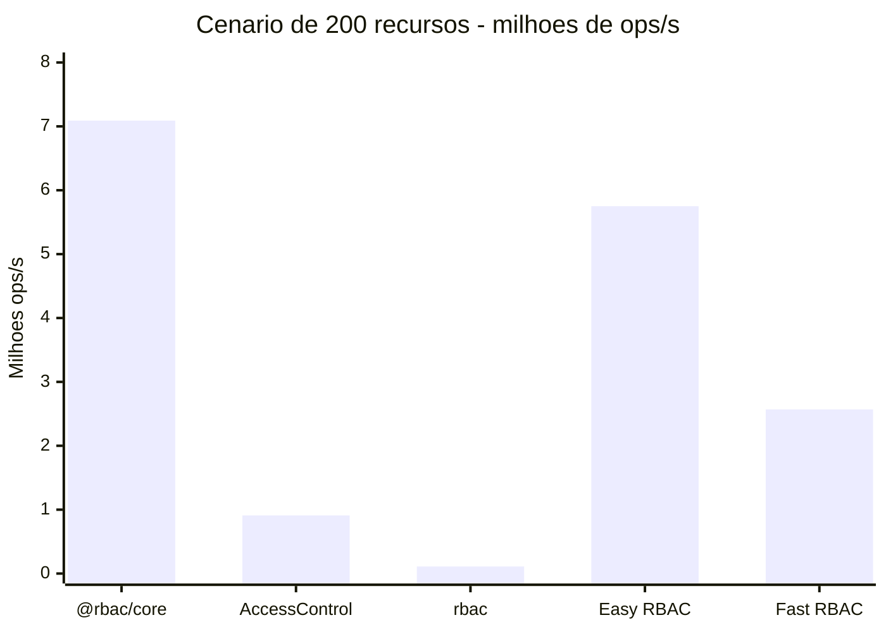
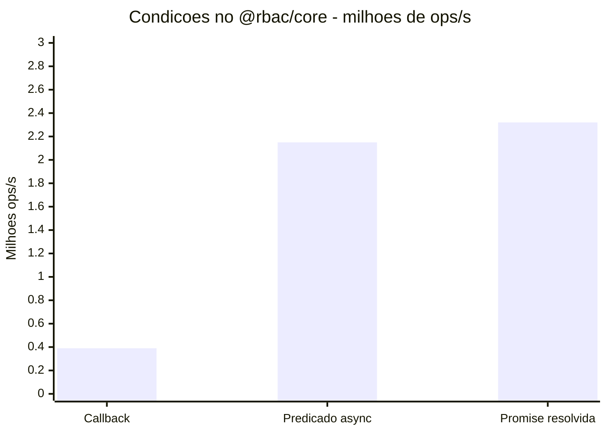

# Benchmarks de desempenho do RBAC

Medições de **14 de novembro de 2026**, com **Node.js 22.14.0**, **Windows 11 Pro / Intel Core i7-9700KF**. Todos os valores representam **operações por segundo (ops/s)**; quanto maior, melhor. Os testes utilizam os pacotes v4 compilados, com logs desativados.

## Comparação entre bibliotecas

Foram comparados `@rbac/core`, `accesscontrol@2.2.1`, `rbac@5.0.3`, `easy-rbac@4.0.0` e `fast-rbac@2.0.1`. O cenário pequeno contém poucas roles e permissões; o cenário grande usa **200 recursos**, herança, permissões exatas e padrões glob.

### Verificações de permissão direta





### Comparativo completo (ops/s)

| Biblioteca | Direta (pequeno) | Herdada (pequeno) | Glob (pequeno) | Direta (grande) | Herdada (grande) | Glob (grande) |
| --- | ---: | ---: | ---: | ---: | ---: | ---: |
| **@rbac/core** | **7.282.499** | **7.330.012** | **3.982.917** | **7.086.106** | **7.009.957** | **3.527.345** |
| AccessControl | 943.635 | 668.308 | — | 908.823 | 530.274 | — |
| rbac | 209.160 | 201.247 | — | 111.538 | 53.201 | — |
| Easy RBAC | 6.119.410 | 364.966 | 3.091.113 | 5.747.234 | 5.504.564 | 122.253 |
| Fast RBAC | 2.989.702 | 2.871.606 | 2.840.481 | 2.567.862 | 2.629.421 | 2.600.415 |

O travessão indica que a biblioteca foi testada em um cenário de **permissão administrativa**, sem uma API glob diretamente equivalente. Cada medição inclui a chamada `can()` própria da biblioteca e o `await` do callback medido. Como as APIs e os modelos de permissão diferem, o comparativo é uma **referência de throughput**, sem comprovar semântica idêntica ou liderança universal.

## Autorização condicional

O cenário grande também mede as permissões condicionais do `@rbac/core`:



| Tipo de condição | Ops/s |
| --- | ---: |
| Callback no estilo Node.js (com `setImmediate`) | 388.996 |
| Predicado assíncrono | 2.152.776 |
| Promise resolvida | 2.316.798 |

O callback agenda trabalho adicional, portanto esses valores **não equivalem** ao custo de uma condição síncrona.

## Medições isoladas do motor

`npm run bench:engine` executa **300.000 verificações por amostra**, com **50.000 verificações de aquecimento** e **cinco amostras por cenário**. A tabela mostra a mediana de ops/s nessa execução independente:

| Cenário | Ops/s | Cenário | Ops/s |
| --- | ---: | --- | ---: |
| Permissão exata | 11.821.309 | Permissão herdada | 12.864.770 |
| Glob simples | 5.220.169 | Permissão com regex | 2.685.078 |
| Condição síncrona | 2.357.719 | Condição assíncrona | 2.596.618 |
| Condição negada | 2.489.162 | Operação inexistente | 5.162.996 |
| Role desconhecida | 14.075.652 | Consulta com regex | 1.168.111 |

Esse teste usa uma metodologia diferente do comparativo entre bibliotecas. **Não compare diretamente o throughput absoluto das duas suítes.**

## Microbenchmark

O comando `npm run bench:micro` mede uma permissão exata usando uma string constante ou uma operação interpolada. A função nativa `Set.has()` serve como referência da linguagem:

| Operação | String constante (ops/s) | String interpolada (ops/s) |
| --- | ---: | ---: |
| Permissão exata no RBAC | 14.055.829 | 3.662.664 |
| `Set.has()` nativo | 16.382.823 | 3.739.846 |

Essa medição é independente; a operação nativa de Set não implementa toda a semântica de autorização da biblioteca.

## Reprodução e resultados

Na raiz do repositório:

```bash
npm ci
npm run build
npm run bench:engine
npm run bench
```

`npm run bench` grava amostras, estatísticas e gráficos interativos em `benchmarks/results/`. Arquivos desta medição:

- [Cenário pequeno: JSON](https://github.com/phellipeandrade/rbac/blob/master/benchmarks/results/rbac-comparison.json) · [CSV](https://github.com/phellipeandrade/rbac/blob/master/benchmarks/results/rbac-comparison.csv) · [Gráfico HTML](https://github.com/phellipeandrade/rbac/blob/master/benchmarks/results/rbac-comparison.chart.html)
- [200 recursos: JSON](https://github.com/phellipeandrade/rbac/blob/master/benchmarks/results/rbac-comparison-large.json) · [CSV](https://github.com/phellipeandrade/rbac/blob/master/benchmarks/results/rbac-comparison-large.csv) · [Gráfico HTML](https://github.com/phellipeandrade/rbac/blob/master/benchmarks/results/rbac-comparison-large.chart.html)
- [Benchmark do motor: JSON](https://github.com/phellipeandrade/rbac/blob/master/benchmarks/results/rbac-engine.json)

Os números dependem da CPU, carga do sistema, aquecimento do JIT e versão do Node.js. Repita as medições em condições equivalentes, valide o resultado das autorizações em cada API e teste suas próprias regras antes de concluir sobre desempenho. Veja também a [metodologia dos benchmarks](https://github.com/phellipeandrade/rbac/blob/master/benchmarks/benchmark.md).
